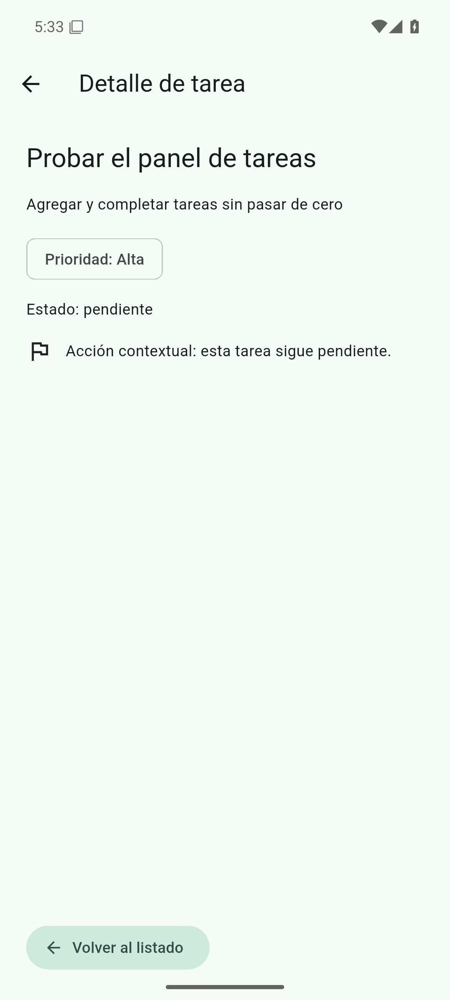
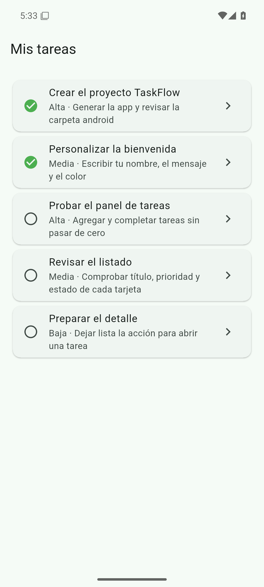

# TaskFlow

App de tareas del curso de Flutter. En esta sesión, `go_router` abre el detalle de una tarea y permite volver al listado. La guía del laboratorio sigue en [LEEME.md](LEEME.md). La procedencia de las capturas está en [EVIDENCIAS.md](EVIDENCIAS.md).

## Objetivo

Mostrar un listado de tareas de ejemplo y, al tocar una tarjeta, la ficha de esa tarea. La ruta del detalle lleva el id (`/task/:id`). Al volver, el listado sigue en pantalla.

## Qué hace la app

El código está en `lib/main.dart`.

- `GoRouter` define dos rutas: `/` (`TaskListScreen`) y `/task/:id` (`TaskDetailScreen`).
- El listado se titula **Mis tareas**. Cada tarjeta muestra el título, la prioridad, la descripción y un icono de estado (completada o pendiente).
- Al tocar una tarjeta, `context.push('/task/${id}')` abre el detalle. El detalle busca esa tarea en `demoTasks`.
- El detalle muestra el título, la descripción completa, un chip `Prioridad: …`, el texto `Estado: completada` o `Estado: pendiente`, y una acción contextual cuyo icono y frase cambian con el estado.
- **Volver al listado** llama a `context.pop()`. La barra de la pantalla de detalle también muestra la flecha atrás.
- Hay cinco tareas de ejemplo, con prioridades Alta, Media y Baja.
- El tema es Material 3, con color de semilla `#1F6F5B`.

## Requisitos

Declarados en `pubspec.yaml`:

| Paquete | Restricción |
| --- | --- |
| Dart | `sdk: ^3.13.7` |
| Flutter | SDK |
| `go_router` | `^18.1.3` |
| `cupertino_icons` | `^1.0.8` |
| `flutter_test` | SDK, dependencia de desarrollo |
| `flutter_lints` | `^6.0.0`, dependencia de desarrollo |

`pubspec.lock` deja resueltos `go_router` 18.1.3, `cupertino_icons` 1.0.9 y `flutter_lints` 6.0.0. El mismo archivo anota Dart `>=3.13.7 <4.0.0` y Flutter `>=3.47.0`. La app usa `publish_to: none` y la versión `1.0.0+1`.

## Ejecutar

```bash
flutter pub get
flutter run
```

## Comprobar

Los comandos que ya indica [LEEME.md](LEEME.md):

```bash
dart format lib
flutter analyze
flutter test
```

`flutter test` ejecuta la prueba que está en `test/widget_test.dart`: `cada tarjeta abre su detalle y se puede volver`. Esa prueba abre las tareas «Crear el proyecto TaskFlow», «Probar el panel de tareas» y «Preparar el detalle», y comprueba la ruta (`/task/1`, `/task/3`, `/task/5` y la vuelta a `/`), la prioridad, el estado, la acción contextual y el regreso al listado.

## Estructura

- `lib/main.dart` — interfaz, datos de ejemplo y rutas
- `test/widget_test.dart` — prueba de navegación
- `pubspec.yaml`, `pubspec.lock` — dependencias
- `LEEME.md` — guía de la sesión
- `EVIDENCIAS.md` — procedencia de las capturas
- `docs/evidencias/` — PNG y MP4 de esta sesión
- `android/` — aplicación `com.example.taskflow`
- `ios/`, `linux/`, `macos/`, `web/`, `windows/` — plataformas del proyecto Flutter

## Evidencias en el emulador

Capturas del emulador Android remoto AVD `taskflow_api35` (Android 15, API 35), tomadas con Flutter 3.47.9. El detalle está en [EVIDENCIAS.md](EVIDENCIAS.md).

### Listado

Ruta `/`. Título **Mis tareas**. Las dos primeras tarjetas están completadas y las tres siguientes pendientes. Cada una muestra prioridad y descripción.


### Detalle

Detalle de **Probar el panel de tareas** (id 3, ruta `/task/3`): descripción, chip **Prioridad: Alta**, **Estado: pendiente**, acción contextual de tarea pendiente y el botón **Volver al listado**.



### Regreso

El listado **Mis tareas** otra vez, después de **Volver al listado**. Las cinco tarjetas siguen en pantalla.



### Video

El archivo dura 9 s (9,13 s medidos). Empieza en **Mis tareas**, abre el detalle de **Probar el panel de tareas** y termina otra vez en el listado. Lo grabó `screenrecord` en el emulador.

[Abrir o descargar sesion-04-listado-detalle-regreso.mp4](docs/evidencias/sesion-04-listado-detalle-regreso.mp4)

GitHub no reproduce este MP4 dentro del README. El enlace abre el archivo en el repositorio para verlo o descargarlo.
